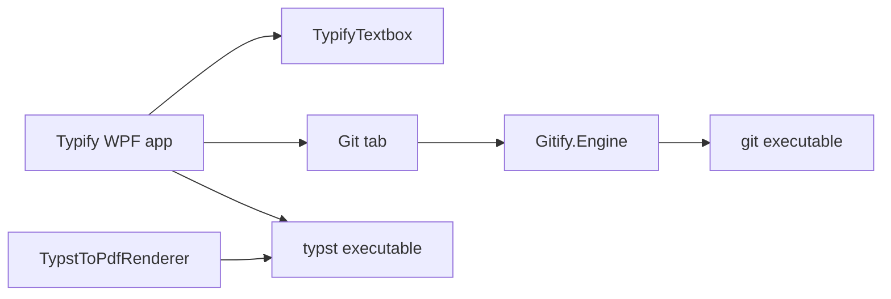

# Typify

Typify is a Windows desktop workspace for writing Typst documents, previewing the current source, exporting PDFs, and managing Git repositories. This repository contains the application and three related projects: a reusable Typst editor, a Git process integration library, and a standalone PDF renderer wrapper.

## Documentation

| Project | Description | Full documentation |
| --- | --- | --- |
| `Typify` | WPF application, explorer, editor, live preview, PDF export, themes, Git tab | [Typify application manual](Typify/README.md) |
| `TypifyTextbox` | Reusable WPF source editor with Typst syntax highlighting | [Editor control reference](TypifyTextbox/README.md) |
| `Gitify.Engine` | UI-independent Git command execution and parsing library | [Git engine reference](Gitify.Engine/README.md) |
| `TypstToPdfRenderer` | Command-line wrapper around the Typst compiler | [Renderer reference](TypstToPdfRenderer/README.md) |

## Solution layout

```text
Typify.slnx
├── Typify/               WPF application
├── TypifyTextbox/        Reusable WPF editor control
├── Gitify.Engine/        Git command/process library
└── TypstToPdfRenderer/   Standalone console executable
```



`Typify` references `TypifyTextbox` and `Gitify.Engine`. The renderer is independent and is not invoked by the app. Both the app and renderer delegate Typst compilation to the external Typst CLI.

## Requirements

- Windows for the WPF desktop application.
- .NET Framework 4.7.2 runtime to run the application. Building requires the .NET Framework 4.7.2 developer pack and Visual Studio/MSBuild able to load the `.slnx` solution and legacy `.csproj` projects.
- Typst CLI executable named `typst` on `PATH` for live preview and the app's PDF export. `TypstToPdfRenderer` additionally supports an explicit compiler path.
- Git executable named `git` on `PATH` for Git features.

Git credentials should be configured in Git (credential helper, SSH agent/key, or another supported Git setup). Background commands close standard input and disable `GIT_TERMINAL_PROMPT`; use the Git tab's **Run in terminal** action for operations that require an interactive prompt.

## Build and launch

Open `Typify.slnx` in a compatible Visual Studio installation and build `Debug` or `Release`. To build only the app, build `Typify/Typify.csproj`; its project references build the editor and Git library. Build the renderer independently from `TypstToPdfRenderer/TypstToPdfRenderer.csproj`. The application executable is written to `Typify/bin/<Configuration>/` by the project settings.

Run `Typify.exe` from its output directory and ensure the external `typst` and `git` programs are present on that process's `PATH`. The console renderer is produced under `TypstToPdfRenderer/bin/<Configuration>/`.

## First use

1. Configure the workspace root in `Typify/MainWindow.xaml.cs` by setting `_workingDirectory` to the Typst project folder. By default, the app resolves the repository root relative to its output directory when it finds `Typify.slnx`, and otherwise uses the output directory.
2. Start the app. Expand folders in **Workspace > Explorer** and double-click a `.typ` file to load it.
3. Edit source in the center pane. The right pane recompiles after a short debounce and displays rendered pages or compiler diagnostics.
4. Use **Export PDF** to compile a `.typ` file from disk to a chosen PDF path.
5. Use the **Git** tab for common repository work, or its Git command tab for other Git operations.

## Current behavior and limitations

- The source control edits an in-memory buffer. The current application UI has no save action; opening a file replaces the editor buffer. The export dialog compiles the selected on-disk source file, not unsaved editor text.
- Live preview recompiles to temporary PNG pages at 72 PPI using `typst compile`. It is a fresh CLI compilation after editor changes, not an embedded compiler or incremental layout engine. Imported source and asset changes on disk do not themselves trigger a preview; edit the main buffer to trigger another compile.
- The working directory serves as Typst's `--root`, which constrains accessible project files. Imported files should remain within the configured root and be resolvable from the source file's folder.
- The explorer loads directory contents lazily but does not apply `.gitignore` filtering. It is a file browser; only `.typ` files open in the editor.
- `TypifyTextbox` implements lexical syntax colorization, not a complete Typst parser, language server, formatter, or diagnostics service.
- The Git tab exposes common workflows. `Gitify.Engine` passes subcommands to Git rather than reimplementing Git's storage, merge, authentication, or network protocols.
- Theme choice and selected paths are not persisted between application runs.

## Related references

- [Typst documentation](https://typst.app/docs/)
- [Typst command-line reference](https://typst.app/docs/reference/cli/)
- [License](LICENSE.txt)
